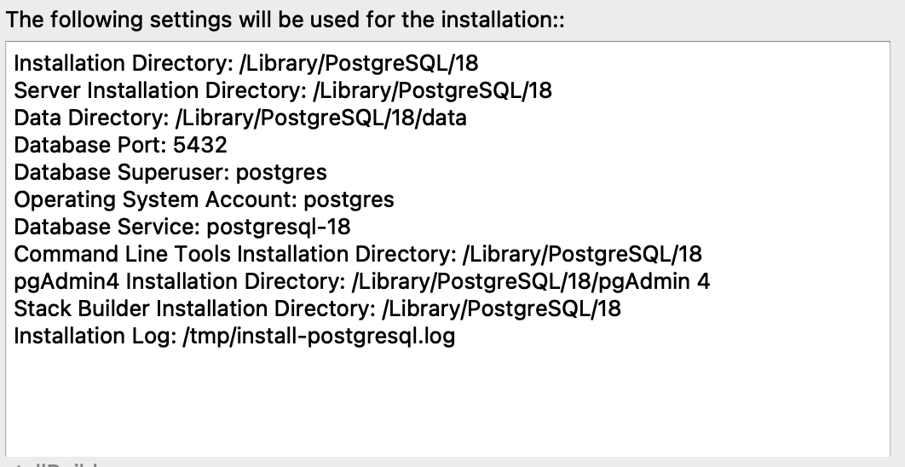
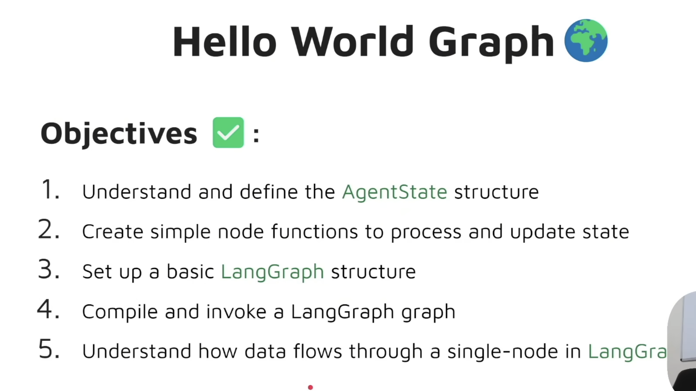
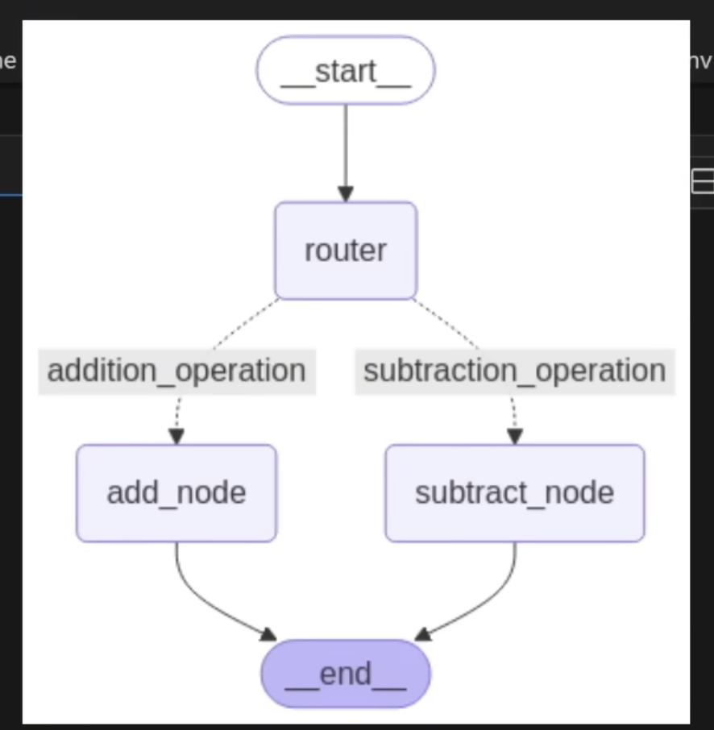
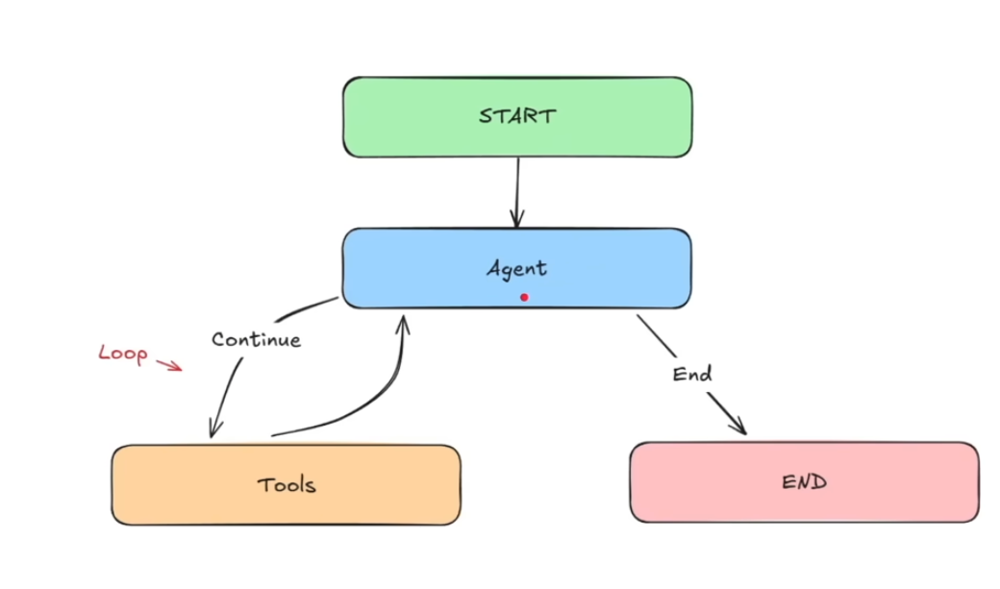

# AIwithAshish

## Project Description

AIwithAshish is an intelligent agent orchestration platform that leverages advanced AI/ML technologies to build and deploy sophisticated multi-agent systems. The project combines LangGraph for workflow orchestration, FastAPI for backend services, and cutting-edge LLM inference to create intelligent agents capable of complex decision-making and task execution.

This platform supports multiple agent types including a React agent, a drafter agent, and custom Azure OpenAI-powered agents. It enables conditional routing, looping workflows, and multi-route graph execution for flexible and powerful agent behavior. The system is designed to scale efficiently using cloud infrastructure and is production-ready with comprehensive quality assurance tools.

**Key Features:**
- Multi-agent orchestration with LangGraph
- Conditional workflow graphs
- Looping workflow graphs
- Multi-route workflow graphs
- React agent implementation
- Drafter agent implementation
- Azure OpenAI integration

## Tech Stack

### AI/ML

| Component   | Technology                                          |
|-------------|-----------------------------------------------------|
| Backend     | FastAPI                                             |
| Orchestration | LangGraph — orchestrate the AI agents             |
| Inference   | Groq — fast and free LLM inference                 |
| Embeddings  | Jina AI                                             |
| Database    | PostgreSQL with PGVector for vector search          |
| Hosting     | Vercel (free tier)                                  |

### Infrastructure & DevOps

| Area    | Tools                                               |
|---------|-----------------------------------------------------|
| Infra   | AWS free tier ($200 credits)                        |
| DevOps  | OpenTofu, CircleCI / GitHub Actions, GitHub, Docker |
| Quality | Sentry, Opik, CloudWatch, Ruff, MyPy                |

## Screenshots







### React Agent



## Setup

### PostgreSQL

```bash
brew services start postgresql@14
psql --version
```

### Azure OpenAI API Key

```bash
echo 'export AZURE_OPENAI_API_KEY="api_key"' >> ~/.zshrc
source ~/.zshrc
```

- Dashboard: https://platform.openai.com/
- API Keys: https://platform.openai.com/api-keys

## Debugging

```
n            # next
s            # step in
p <variable> # print variable
c            # continue
```

| Type           | Emoji   | Example Usage                              |
| -------------- | ------- | ------------------------------------------ |
| Info           | ℹ️      | `print("ℹ️ Info: Starting service...")`    |
| Success        | ✅       | `print("✅ WebSocket connected")`           |
| Warning        | ⚠️      | `print("⚠️ High memory usage detected")`   |
| Error          | ❌      | `print("❌ Failed to fetch data")`          |
| Critical       | 🔥      | `print("🔥 System overload")`              |
| Debug          | 🐞      | `print("🐞 Debug: packet =", packet)`      |
| Ping/Pong      | 📡 / 🏓 | `print("🏓 Pong received from server")`    |
| Connecting     | 🌐      | `print("🌐 Connecting to WebSocket...")`   |
| Reconnecting   | ♻️      | `print("♻️ Reconnecting...")`              |
| Disconnect     | 🔌      | `print("🔌 WebSocket disconnected")`       |
| Cleanup        | 🧹      | `print("🧹 Cleaning up resources")`        |
| Subscribed     | 📬      | `print("📬 Subscribed to ticker XYZ")`     |
| Unsubscribed   | 📭      | `print("📭 Unsubscribed from ticker XYZ")` |
| Packet Decoded | 📦      | `print("📦 Decoded packet:", packet)`      |
| Retry Attempt  | 🔁      | `print(f"🔁 Attempt {n}/5 to reconnect")`  |
| Timestamp      | 🕒      | `print("🕒 Received at:", timestamp)`      |
| File Read      | 📄      | `print("📄 Loaded tickers.txt")`           |
| Market Closed  | 🛑      | `print("🛑 Market closed")`                |
| Market Up      | 📈      | `print("📈 Price moving up")`              |
| Market Down    | 📉      | `print("📉 Price moving down")`            |
| Bullish Move   | 🟢      | `print("🟢 Bullish crossover detected")`   |
| Bearish Move   | 🔻      | `print("🔻 Bearish crossover detected")`   |
🔻
🔔
 # 🔒 ACQUIRE LOCK
 | Type                | Emoji   | Example Usage                                      |
|---------------------|---------|----------------------------------------------------|
| Trade Executed      | 🛒      | `print("🛒 Trade executed at price", price)`        |
| Trade Rejected      | 🚫      | `print("🚫 Trade rejected")`                        |
| Trade Pending       | ⏳      | `print("⏳ Trade pending confirmation")`            |
| Profit              | 💰      | `print("💰 Profit booked:", profit)`                |
| Loss                | 💸      | `print("💸 Loss incurred:", loss)`                  |
| Watchlist           | 👀      | `print("👀 Watching symbol:", symbol)`              |
| Alert               | 🚨      | `print("🚨 Price alert triggered!")`                |
| Settings/Config     | ⚙️      | `print("⚙️ Loading config...")`                    |
| Chart/Graph         | 📊      | `print("📊 Chart updated")`                        |
| Calculation         | 🧮      | `print("🧮 Calculating indicators...")`             |
| API Call            | 🌐      | `print("🌐 API request sent")`                      |
| Database            | 🗄️      | `print("🗄️ Writing to database")`                   |
| Save/Write          | 💾      | `print("💾 Data saved")`                            |
| Loading             | ⏱️      | `print("⏱️ Loading data...")`                      |
| Refresh/Update      | 🔄      | `print("🔄 Data refreshed")`                        |
| Star/Favorite       | ⭐      | `print("⭐ Favorite symbol added")`                  |
| Question/Help       | ❓      | `print("❓ Need help?")`                            |
| Up Arrow            | ⬆️      | `print("⬆️ Price breakout detected")`               |
| Down Arrow          | ⬇️      | `print("⬇️ Price breakdown detected")`              |
| Pause               | ⏸️      | `print("⏸️ Pausing trading...")`                    |
| Resume              | ▶️      | `print("▶️ Resuming trading...")`                   |
| Lock/Unlock         | 🔒/🔓   | `print("🔒 Lock acquired")` / `print("🔓 Lock released")` |


£ To see the port
lsof -nP -iTCP:11434 -sTCP:LISTEN


# reach it from your Mac (a port-forward to 8080 is open right now)
kubectl port-forward svc/chat-api 8080:5002
curl -X POST localhost:8080/api/chat -H 'Content-Type: application/json' -d '{"prompt":"hi"}'

# redeploy after code changes: push to main (the runner below deploys), or by hand:
minikube image build -t chat-api:latest . && kubectl rollout restart deploy/chat-api

## Deploy on push (self-hosted runner)

`.github/workflows/deploy.yml` runs on this Mac's runner (`~/actions-runner-ai-chat`) on every push to main that
changes app.py, src/, the Dockerfile, k8s/ or the workflow (or by hand: Actions > Deploy chat-api > Run workflow).
It builds `chat-api:v<run>-<sha>` inside minikube, applies k8s/chat-api.yaml, sets the image and waits for the
rollout. The launchd port-forward (127.0.0.1:5050) reconnects by itself a few seconds after.

Register the runner once (token: GitHub > AIwithAshish > Settings > Actions > Runners > New self-hosted runner,
valid for an hour):
```bash
mkdir -p ~/actions-runner-ai-chat && cd ~/actions-runner-ai-chat
tar xzf ~/actions-runner-ai-authz/actions-runner-osx-arm64-*.tar.gz
./config.sh --url https://github.com/ashishsober/AIwithAshish --token <TOKEN> --name Ashishs-Mac-Studio --unattended
./svc.sh install && ./svc.sh start
```

## Qwen Chat history (per signed-in user)

chat-api saves each signed-in person's chats in MySQL `chat_db` and sends the chat so far to the model
as context (newest messages first, up to `CHAT_CONTEXT_CHARS`, default 60,000 characters).
nginx passes the person as `X-Auth-User-Id`; everyone sees only their own chats. On the LAN address
(:8080, no sign-in) nothing is saved and the page sends the chat for context itself.

| Endpoint | |
|---|---|
| `POST /api/chat` `{prompt, conversation_id?}` | ask; no `conversation_id` starts a new chat |
| `GET /api/chat/conversations` | your chats, newest first |
| `GET /api/chat/conversations/<id>` | one chat with its messages |
| `PATCH /api/chat/conversations/<id>` `{title}` | rename |
| `DELETE /api/chat/conversations/<id>` | delete |

One-time setup (asks for the MySQL root password, prints no secrets): `setup/bootstrap.sh`
creates `chat_db` (sql/001_chat_db.sql), the MySQL user `chat_api` and the Secret `chat-secrets`.
Without that Secret the pod still answers and keeps nothing.

Also needed once: the route rules in ai-authorization-api `sql/003_chat_history_routes.sql`, and the
`location /api/chat/` block in nginx's aisoup-locations.conf.

## Qwen Chat plans and daily limits

Each signed-in person may ask their plan's number of questions a day and a week; a question needs room in both.
Days start at midnight (India time); weeks run Monday to Sunday. A question over a limit gets **429** with a
message, and is never sent to the model. A question
the model fails to answer is not counted. Deleting chats does not give questions back.

| Plan | A day | A week | |
|---|---|---|---|
| Free | 25 | 100 | everyone starts here |
| Plus | 100 | 400 | ask for it on the Upgrade plan page |
| Pro | 300 | 1,200 | ask for it on the Upgrade plan page |

Change a limit in MySQL, e.g. `UPDATE chat_db.plans SET daily_questions = 50, weekly_questions = 200 WHERE code = 'free';`
(NULL = no limit of that kind). The usage page also warns when, at the person's current pace, a limit would run
out before it resets. **Super admins have no limit** (chat-api asks authz-api, using the `authz-internal`
Secret). There are no payments: a request waits until a super admin approves it in the app's
Admin > Qwen Chat plans, where they can also put anyone on any plan. nginx's 10 questions a minute still applies.

| Endpoint | |
|---|---|
| `GET /api/chat/usage` | your plan, today and this week against the limits, the pace warning, questions per day for 30 days, saved chats |
| `GET /api/chat/plans` | the plans, yours, and your latest request |
| `POST /api/chat/plan-requests` `{plan, note?}` | ask for a bigger plan (replaces a pending request) |
| `DELETE /api/chat/plan-requests/current` | cancel your pending request |
| `GET /api/chat/admin/overview` | super admins: plans, requests, everyone's plan and usage |
| `POST /api/chat/admin/plan-requests/<id>/decision` `{approve}` | approve or decline |
| `PUT /api/chat/admin/users/<user_id>/plan` `{plan}` | put someone on a plan |

Admin changes need the header `X-Requested-With: AITradeSoup`.

Set up once on an existing install (both as MySQL root, then deploy chat-api as usual):
```bash
mysql -u root -p < sql/002_chat_plans.sql                                        # tables, plans, past questions
mysql -u root -p < ../ai-authorization-api/sql/004_chat_plan_admin_routes.sql   # /api/chat/admin/ = super admins
```

Tests (no MySQL or model needed): `python -m pytest -q tests`
